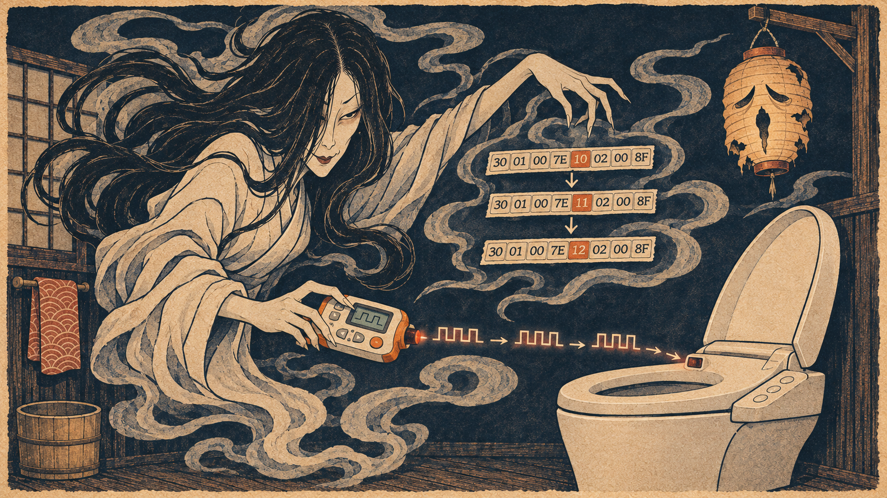

# IR Toilet Fuzzer

> **Warning:** Use only on devices you personally own. Do not use it on anyone else's devices. Fuzzing can brick devices or permanently damage them.



A Flipper Zero app to capture, compare and fuzz toilet IR commands.

**Install:** Run `make`, then copy the generated `dist/ir_boundary_lab.fap` to `/apps/Infrared/`. Build outputs are kept locally and excluded from Git.

**Use:** Capture/sniff → save profile → load → choose byte range → fuzz. Press **OK** to pause and save.

**Build:** Requires GNU Make and Python 3 with pip/venv support, plus `wget` for pinned SDK downloads. No manual activation needed:

```sh
make                         # Latest stable Unleashed (default)
make SDK_RELEASE=unlshd-084  # Optional: Unleashed 084
make SDK_RELEASE=unlshd-093  # Optional: Unleashed 093
```

First build installs `ufbt` in `.venv/` and downloads the matching SDK/toolchain into `.ufbt/`. The default checks the [Unleashed stable release channel](https://up.unleashedflip.com/directory.json) on every build and updates the SDK when a new stable release is available. Pinned releases cache their SDK archives in `lib/` and reuse their installed SDK. Pass `SDK_LOCAL=/path/to/sdk.zip` to use an existing archive. SDK/build state is separate for each target; the toolchain is shared.

Output: `dist/ir_boundary_lab.fap`. Match the SDK to your installed firmware: an **incompatible SDK/API** error means you should rebuild for that firmware and replace the app on the SD card. Use `make` for current stable Unleashed, or set `SDK_RELEASE` to your installed release if you are staying on an older version. `make sdk` refreshes the selected SDK; `make help` lists commands.
